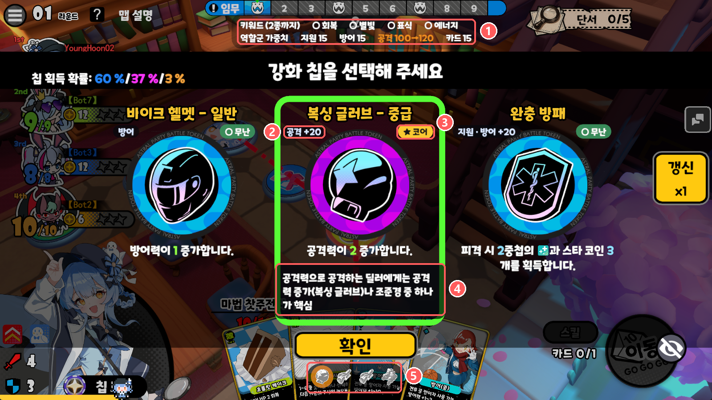

# Astral Party 칩 선택 가이드

[](https://github.com/YoungHoon02/astral-party-chip-guide/releases/latest)
[](https://github.com/YoungHoon02/astral-party-chip-guide/releases)
[](https://builds.bepinex.dev/projects/bepinex_be)
[](LICENSE)

PvE에서 레벨업 칩을 고를 때, **지금 내 상황에 어떤 칩이 좋은지** 칩 카드마다 알려 주는 모드입니다.



1. **키워드 패널**: 키워드 4종의 보유·막힘 상태와 내 역할군 가중치. 칩을 선택하면 그 칩의 키워드는 초록색, 막힐 키워드는 주황색, 바뀔 가중치는 주황색(공격 100→120)으로 미리 보입니다.
2. **역할군 태그**: 그 칩의 역할군과 고르면 더해지는 가중치
3. **판정 배지**: `★ 코어` / `○ 무난` / `× 보류`. 키워드 고정 경고는 `※`
4. **판정 이유**: 칩을 클릭해 선택하면 칩 설명 아래에 나옵니다.
5. **코어 칩 줄**: 내 캐릭터의 코어 칩. 가진 칩은 컬러, 없는 칩은 회색이고, 선택한 칩이 코어면 같은 아이콘이 주황색으로 점멸합니다.

F10을 누르면 모드 표시를 한 번에 숨기거나 다시 보여 줍니다.

## 이런 걸 알려 줘요

**칩마다 추천 배지**
- 칩 아이콘 오른쪽 위에 `★ 코어` / `○ 무난` / `× 보류` 배지가 붙습니다.
- 칩을 클릭해 선택하면 칩 설명 아래에 **왜 그런지** 이유가 나옵니다.
- 배지가 없는 칩도 선택하면 "판정 규칙 없음"과 함께 역할군 가중치 변화, 키워드 영향을 보여 줍니다.
- 내 캐릭터, 이미 가진 칩, 같이 하는 아군, 맵을 보고 판정합니다. 예를 들어 아군에 회복 서포터가 있으면 아드레날린은 보류입니다.
- 낮은 등급이 나오면 "보라 이상 권장"처럼 알려 줍니다.
- 쓸 만하지만 효과가 일부만 나는 칩은 무난으로 두고 `주의:`로 이유를 알려 줍니다.

**키워드 칩 고정 경고**
- 키워드 칩(회복·스타라이트·표식·에너지)은 **두 종류를 고르면 나머지 두 종류가 그 판에서 더 나오지 않습니다.**
- 키워드를 한 종류만 가졌을 때 다른 키워드 칩이 나오면 `※`를 붙여, 고르면 무엇이 막히는지 알려 줍니다. 그 선택으로 내 캐릭터의 코어 칩까지 막히면 함께 알려 줍니다.

**역할군 가중치**
- 칩 아이콘 왼쪽 위에 그 칩의 역할군과 고르면 더해지는 가중치가 보입니다. 예: `공격 +40`, `방어 +10 · 공격 +30`, `방어`
- 키워드 패널 둘째 줄에 내 캐릭터의 현재 역할군 가중치(지원·방어·공격·카드)가 보이고, 가장 높은 역할군은 강조됩니다.
- 칩을 클릭해 선택하면 `공격 15→55`처럼 고른 뒤의 가중치를 미리 보여 줍니다.
- 게임 설정 데이터의 값을 그대로 보여 주는 참고 정보입니다. 이 값이 선택지 등장에 어떻게 쓰이는지는 확인되지 않아, 판정에는 쓰지 않고 확률(%)도 계산하지 않습니다.

**키워드 패널**
- 칩 선택 창 제목 띠 바로 위 가운데에 키워드 4종의 상태가 한 줄로 늘 보입니다.
  - `●` 가진 키워드(개수)
  - `○` 아직 얻을 수 있는 키워드
  - `×` 더 나오지 않는 키워드 (회색)
- 칩을 클릭해 선택하면 그 칩의 키워드가 초록색으로 바뀌고, `※` 칩이면 막힐 키워드가 주황색으로 미리 보입니다.
- 막혔거나 막힐 키워드 옆에는 그 칩들의 아이콘이 나오고, 아이콘에 마우스를 올리면 이름이 보입니다.

**코어 칩 줄**
- 확인 버튼 바로 아래에 내 캐릭터의 코어 칩 아이콘이 늘어섭니다. 아직 없는 칩은 회색, 가진 칩은 컬러입니다.
- 코어 칩 카드를 클릭해 선택하면 줄의 같은 아이콘 뒤에서 주황색 빛이 천천히 점멸합니다.
- 아이콘에 마우스를 올리면 이름이 보입니다. 다른 맵 전용 칩은 빠집니다.

**표시 숨기기**
- F10을 누르면 칩 선택 창의 모드 표시를 한 번에 숨기고, 다시 누르면 보여 줍니다.

## 설치

1. [BepInEx 6 IL2CPP](https://builds.bepinex.dev/projects/bepinex_be)를 Astral Party(INT 클라이언트)에 설치하고, 게임을 한 번 켰다 끕니다.
2. **BepInEx 로그 설정을 바꿉니다.** `BepInEx\config\BepInEx.cfg`를 메모장으로 열어 `[Logging]` 아래의 값을 `false`로 바꾸세요. 기본값 `true`로 두면 일부 환경에서 로고 직후 게임이 꺼집니다.
   ```ini
   [Logging]
   UnityLogListening = false
   ```
3. [최신 릴리스](https://github.com/YoungHoon02/astral-party-chip-guide/releases/latest)에서 ZIP을 받습니다.
4. ZIP을 게임의 `BepInEx\` 폴더 안에 풉니다. `BepInEx\plugins\AstralPartyChipGuide\` 폴더가 생기면 됩니다.
5. 게임을 켜고 로비에 한 번 들어가면 준비가 끝납니다. 그다음부터 PvE 칩 선택 창에 배지가 나옵니다.

## 알아 두면 좋은 점

- **PvE에서만** 나옵니다. PvP, 관전, 리플레이에서는 아무것도 표시하지 않습니다.
- 화면에 정보만 더할 뿐, 칩을 대신 고르거나 게임의 원래 추천 표시를 바꾸지 않습니다.
- 게임 안에서는 인터넷을 쓰지 않습니다. 새 버전 확인만 게임 밖 프로그램이 따로 합니다([아래](#새-버전-알림)).
- 게임이 업데이트되거나 언어를 바꿔도 다음 실행 때 자동으로 맞춥니다.

## 설정

처음 실행하면 `BepInEx\config\kr.younghoon02.astralparty.chipguide.cfg`가 생깁니다. 메모장으로 열어 `true`/`false`를 바꾸세요.

| 항목 | 기본값 | 설명 |
|---|---|---|
| 일반 > 활성화 | 켬 | 모드 표시 전체를 켜고 끔 |
| 일반 > 키워드 패널 | 켬 | 칩 선택 창 제목 띠 위의 키워드 패널 |
| 일반 > 코어 칩 줄 | 켬 | 확인 버튼 아래 코어 칩 아이콘 |
| 일반 > 키워드 고정 경고 | 켬 | `※` 경고 |
| 일반 > 역할군 가중치 | 켬 | 칩 아이콘 왼쪽 위 역할군·추가 가중치와 현재 가중치 줄 |
| 일반 > 표시 전환 키 | F10 | 모드 표시를 한 번에 숨기거나 다시 보여 줌 |
| 진단 > 상세 로그 | 끔 | 문제를 알려 주실 때 켜 주세요. 칩 창이 열릴 때 읽은 값이 `BepInEx\LogOutput.log`에 남습니다 |
| 업데이트 > 새 버전 확인 | 켬 | 게임을 켤 때 새 버전 확인 |

## 판정이 이상하다면

- 판정의 근거와 순서는 [추천 로직 문서](docs/RECOMMENDATION.md)에 모두 공개해 두었습니다.
- 틀린 판정이나 빠진 조합을 발견하면 [이슈](https://github.com/YoungHoon02/astral-party-chip-guide/issues)로 알려 주세요. 캐릭터, 칩, 상황(아군·맵·가진 칩)과 칩 선택 창 캡처가 있으면 큰 도움이 됩니다.
- 내 게임에서만 바꾸고 싶으면 플러그인 폴더의 `rules.json`을 고치세요. 게임을 켠 채 저장해도 몇 초 안에 반영되고, 잘못 고쳐도 직전 규칙이 유지됩니다. 쓰는 법은 [규칙 작성 안내](docs/RULES.md)에 있습니다.
- `rules.json`은 게임을 처음 켤 때 만들어지고, 모드를 업데이트하면 새 기본 규칙으로 자동으로 바뀝니다. 직접 고친 파일은 `rules.json.bak`으로 남으니, 필요한 부분을 새 파일에 다시 옮기세요.

## 새 버전 알림

게임을 켤 때 새 버전이 있으면 게임 밖에 작은 알림 창이 뜹니다. `업데이트하러 가기`를 누르면 릴리스 페이지가 열리고, `이번 버전은 무시`를 누르면 그 버전은 다시 알리지 않습니다.

- 플러그인 폴더의 `AstralPartyChipGuideUpdater.exe`가 GitHub에 요청 하나만 보냅니다. 계정이나 게임 정보는 보내지 않습니다.
- 알림만 하고, 내려받거나 설치하지는 않습니다.
- 게임을 켜지 않고 확인하려면 그 exe를 직접 실행하세요. 끄려면 설정의 `업데이트 > 새 버전 확인`을 `false`로 바꾸세요.

## 출처와 감사

- 기본 추천: Feiz님의 [「캐릭터별 나왔을 때 집어가면 좋을 코어 칩 및 플레이 방법 가이드」](https://arca.live/b/astralparty/171581722). 작성자의 허락을 받아 사용했습니다.
- 역할군 가중치 정리: [아스트랄 파티의 역할군과 칩 등장 보정](https://arca.live/b/astralparty/181959083), [칩 역할군과 속성 도감](https://arca.live/b/astralparty/185223225) (작성자 허락). 표시하는 값은 게임 데이터에서 직접 읽으며, 글의 등장 확률 설명은 검증되지 않아 따르지 않습니다.
- 맵별·아군 칩별 판정은 [아스트랄 파티 채널](https://arca.live/b/astralparty)의 공략·후기 글과 게임 데이터를 함께 보고 정했습니다.
- 공략에 없는 조합은 칩 설명과 캐릭터 스킬([Astral Party 커뮤니티 위키](https://astralparty.miraheze.org/wiki/Characters))로 추정해 보탰습니다. 어떤 판정이 추정인지는 [추천 로직 문서](docs/RECOMMENDATION.md)에 있습니다.

## v0.4.0

캐릭터를 포지션(평딜러, 스킬 딜러, 돈포터, 힐포터 등)으로 나눠 코어 칩 추천을 다시 짰습니다.

- **키워드가 막혀 코어를 못 고르는 일이 줄었습니다.** 캐릭터마다 코어 키워드를 되도록 하나로 맞춰, 판이 끝날 때 코어 키워드가 막혀 있을 확률이 절반 아래로 줄었습니다(0.135 → 0.061). 첫 레벨업에 ★가 뜨는 비율은 그대로입니다.
- 딜러 공용 코어는 복싱 글러브 하나만 남기고, 표준·이글 아이 조준경은 무난으로 내렸습니다. 표식이 테마인 보니(조준경 2종)와 테루(표준 조준경)는 그대로 코어입니다.
- **효과 카드로 싸우는 코마치·메가스·린에게는 공격력 칩을 보류(×)로 보여 줍니다.** 복싱 글러브·조준경·아드레날린·커터칼처럼 공격력이나 공격할 때 켜지는 칩은 이들의 피해에 들어가지 않습니다. 아군 보니·린이 있을 때의 닌자 수리검·마법 화살통 무난도 이 캐릭터들에게만 뜹니다.
- 코어가 빈약하던 캐릭터는 스킬에 맞는 한 테마로 보강했습니다. 알라나·Z3000·루카·마무시·잉크 섀도우는 에너지, 패드맨·펭·미사키·낸시 루는 회복 칩이 코어입니다. 마무시는 【진룡】 뒤 딜러로 싸우므로 딜러 추천을 받습니다.
- 키트와 맞지 않는 칩을 보류로 바꿨습니다. 루카·테루의 스타 코인 해머, 사이크스의 복싱 글러브·커터칼, 미사키의 아드레날린·숫돌, AL·질 스팅레이의 마법 비전서·대형 배낭 등입니다.
- **캐릭터 스킬을 게임 원문과 다시 대조해** 어긋난 판정 이유를 바로잡고, 새 추천 5건(나르디스가 비타민 알약을 들면 커터칼 코어, 린 책갈피 코어, 타치바나 셰리 쇼크 글러브 코어 등)을 더했습니다.
- **모드를 업데이트하면 `rules.json`이 새 기본 규칙으로 자동으로 바뀝니다.** 쓰던 파일은 `rules.json.bak`으로 남습니다. 이제 업데이트 뒤 `rules.json`을 따로 바꾸지 않아도 됩니다.
- 키워드가 막혀 칩 아이콘이 붙으면 상단 패널의 가중치 줄이 왼쪽으로 쏠리던 문제를 고쳐, 줄마다 가운데 정렬합니다.

## v0.3.1

캐릭터별 코어 칩 추천을 다시 짰습니다.

- **코어가 빈약하던 캐릭터의 추천을 보강했습니다.** 코어가 없거나 추가 배터리 하나뿐이던 캐릭터(사이크스·패니·렌 등)에 스킬과 맞물리는 칩을 코어로 더해, 첫 레벨업 선택지에 ★가 뜨는 경우가 크게 늘었습니다. 공략 코어는 하나도 빼지 않았습니다.
- 딜러 대부분은 둘째 키워드로 회복(커터칼)을, 서포터에는 코인 칩(은행 카드·슈팅 스타·ATM기)을 코어로 넣었습니다.
- 코어끼리 키워드가 막히던 자스민의 조준경, 회복 중심인 도로시 헤이즈의 공격력 칩은 무난으로 내렸습니다. 미미의 휴대용 선풍기는 보라 이상만 코어입니다.
- 테루의 이글 아이 조준경·손전등은 공략 원문대로 보류입니다.
- 패니는 아군 린·보니가 있으면 휴대용 선풍기(보라 이상)가 코어, 질 스팅레이는 아군이 아드레날린·숫돌을 들었으면 우정 배지가 보류입니다.
- 천공위성은 일반 딜러에게 표시하지 않습니다(워터 타운·영혼 축제 포함).
- 10-14 패치에 맞춰 책갈피·워프 엔진·숫돌 판정 이유를 고쳤고, 키워드 이름 별빛을 스타라이트로 바꿨습니다.

> 이미 설치했다면 플러그인 폴더의 `rules.json`도 새 파일로 바꿔야 새 추천이 적용됩니다.

## v0.3.0

화면 배치를 새로 짜고, 칩을 클릭해 고르는 방식으로 바꿨습니다.

- **설치 방법이 바뀌었습니다.** ZIP을 `BepInEx\plugins\`가 아니라 `BepInEx\` 폴더에 바로 푸세요. 압축 안에 `plugins\AstralPartyChipGuide\`가 들어 있습니다.
- **칩을 클릭하면 정보가 바뀝니다.** 마우스를 올리는 대신 칩을 선택하면 판정 이유, 키워드 변화, 역할군 가중치 변화가 함께 바뀌고 다른 칩을 고를 때까지 유지됩니다.
- **코어 칩 줄이 생겼습니다.** 확인 버튼 아래에 내 캐릭터의 코어 칩 아이콘이 늘어섭니다. 가진 칩은 컬러, 아직 없는 칩은 회색이고, 코어 칩을 선택하면 같은 아이콘이 주황색으로 천천히 점멸합니다.
- **F10으로 모드 표시를 한 번에 숨기거나 다시 보여 줍니다.** names.json은 이제 자동으로만 만들어지고 수동 생성 키는 없어졌습니다.
- 화면 배치를 정리해 게임 글자를 덜 가립니다.
  - 키워드 패널은 "강화 칩을 선택해 주세요" 제목 띠 위로 옮기고, 글자를 줄이고 배경을 투명하게 했습니다.
  - 판정 배지는 작게 줄여 아이콘 오른쪽 위에, 역할군 태그는 아이콘 왼쪽 위에 둡니다.
  - 판정 이유는 칩 설명 아래에 나오고, 확인 버튼을 가리지 않습니다.
- 칩을 고르면 그 칩의 키워드가 상단 패널에서 초록색으로 바뀝니다. 고르면 막힐 키워드는 지금처럼 주황색으로 보입니다.
- 판정 규칙이 없는 칩도 선택하면 "판정 규칙 없음"과 역할군·키워드 영향을 보여 줍니다.
- 판정 이유 첫 줄의 판정 기호(○ 등)는 배지와 겹쳐서 뺐습니다.

## v0.2.0

- **아군이 실제로 든 칩을 보고 판정합니다.** 예: 아군이 고기 가득 스튜나 우정 배지를 들었으면 아드레날린·숫돌은 보류, 아군 딜러가 커터칼을 들었으면 우정 배지·스튜는 무난, 서포터 둘이 ATM기를 들면 코어.
- **맵에 따른 추천을 늘렸습니다.** 원림 중정의 회복 칩, 용궁 유원지의 손패 칩, 워터 타운·영혼 축제의 천공위성, 마법 학교·유령 골목의 슈팅 스타, 영혼 축제 커터칼 주의가 들어갔습니다.
- 맵이나 아군 조건 때문에 캐릭터 코어 칩이 무난으로 내려가던 문제를 고쳤습니다. 예: 워터 타운에서도 코마치의 대형 배낭은 코어입니다.
- 공략 원문을 다시 대조해 판정을 바로잡았습니다.
  - 루카의 이글 아이 조준경·손전등, 복싱 글러브를 든 채 고르는 슈팅 스타는 보류
  - 질 스팅레이의 스마트워치는 코어, 아드레날린을 든 채 고르는 완충 방패는 보류
  - 토노 한나는 회복 아군에서 빼고, 알라나의 아드레날린·숫돌 보류는 풀었습니다
- 마법 학교·원림 중정 전용 칩 판정을 더하고, 레벨업 창에 나오지 않는 칩의 규칙을 정리했습니다.
- `rules.json`에 아군 보유 칩(`allyOwned`)과 역할(`role`) 조건을 쓸 수 있습니다.

## v0.1.0

첫 릴리스입니다.

- PvE 칩 선택 창에서 칩마다 ★ 코어 / ○ 무난 / × 보류 배지와 이유를 보여 줍니다.
- 내 캐릭터, 가진 칩, 아군, 맵에 따라 판정이 달라집니다. 캐릭터 35명의 추천은 Feiz님 공략(허락 받음)을 바탕으로 했고, 공략에 없는 조합은 칩 설명과 캐릭터 스킬로 추정해 보탰습니다.
- 칩 이름 위에 역할군과 추가 가중치를, 키워드 패널에 내 캐릭터의 현재 역할군 가중치를 보여 줍니다.
- 키워드 칩 두 종류를 고르면 나머지가 막힌다는 점을 `※` 경고와 키워드 패널로 알려 줍니다.
- `rules.json`을 고치면 게임을 켠 채 몇 초 안에 반영됩니다.
- 게임을 켤 때 새 버전이 있으면 게임 밖 창으로 알려 줍니다.

## 라이선스

이 저장소의 소스 코드는 [MIT 라이선스](LICENSE)입니다. 누구나 자유롭게 쓰고, 고치고, 다시 배포할 수 있습니다. 다시 배포할 때는 저작권 고지와 라이선스 문구를 함께 넣어 주세요. 이 모드는 있는 그대로 제공되며, 사용으로 생긴 문제에 대해 책임지지 않습니다.

MIT 라이선스는 소스 코드에만 적용됩니다.

- Astral Party 게임 자체와 그 에셋, 게임에서 뽑아낸 데이터(칩·캐릭터·맵 이름, 설정 테이블 등)의 권리는 게임 개발사에 있습니다. 이런 파일은 저장소에 넣지 않습니다.
- 기본 추천 데이터와 역할군 정리의 권리는 각 공략 작성자에게 있습니다([출처와 감사](#출처와-감사)).
- README의 화면 안내 이미지는 게임 화면을 캡처한 것입니다.

개발 관련 내용은 [구조 설명](docs/ARCHITECTURE.md)에 있습니다.
